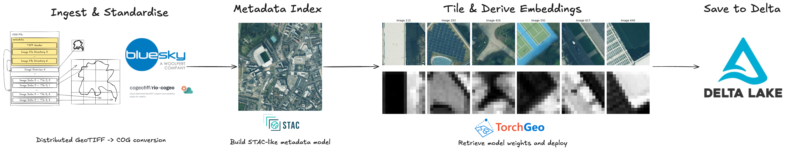

# geoembed

Generate vector embeddings from Cloud Optimised GeoTIFFs (COGs) using Databricks.

## What is geoembed?

`geoembed` is a Python library for generating embeddings from COGs using Geospatial Foundation
Models, such as [DOFA](https://github.com/zhu-xlab/DOFA).

The embeddings pipeline reads entire images onto the GPU, tiles them via `torch.unfold()` using a
chip size and stride calculation, and runs batched inference.

<figure markdown="span">
    
    <figcaption>End-to-end pipeline: COGs → Metadata → GPU tiling → embeddings → Delta. Imagery: Copyright [Bluesky International Ltd](https://bluesky-world.com/).</figcaption>
  </figure>

It runs on Databricks with GPU-accelerated inference via Spark.

It was developed as part of the Ministry of Housing, Communities and Local Government's (MHCLG) AAAI
lab to predict the potential of brownfield land - you can
[read more](https://mhclgdigital.blog.gov.uk/2026/07/16/from-pixels-to-policy-the-potential-of-geospatial-embeddings-for-mhclg/)
about the project.

The embeddings pipeline has been open-sourced in case it is useful for other Databricks' users. Note:
it had specific use case using aerial imagery within great Britain (EPSG:27700), so there are design
choices made around this.

## Key Features

- **Full-image GPU tiling** — reads entire COGs onto GPU and tiles via `torch.unfold()` and a chip
stride calculation
- **Double-buffered I/O** — constantly fetches images for GPU inference
- **Spark-native** — distributes across GPU workers via `mapInPandas`, writes to Delta natively
- **Spatial metadata on-the-fly** — chip bounding boxes computed from affine transform during inference
- **Model registry** — default is DOFA but you can register additional GeoFMs (e.g. Clay)
via `register_model()`

## Architecture

```
COGs → [Spark mapInPandas: FullImageGPUWorker] → Delta Table
         ├─ Read full image (rasterio, background thread)
         ├─ Transfer to GPU (float32, non_blocking)
         ├─ Tile via torch.unfold() and a chip stride calculation
         ├─ Batched inference (DOFA ViT-Base, FP16)
         └─ Compute spatial bounds (affine transform)
```

Currently distributed via Spark `mapInPandas`, but ideally would use
[Ray](https://www.ray.io/)
for running distributed geospatial inference - good examples include
[Wherobots](https://wherobots.com/blog/fields-of-the-world-rasterflow-geoai-pipeline/) and
[Xoople](https://www.anyscale.com/blog/ray-day-london-recap#how-xoople-runs-geospatial-foundation-model-inference-at-global-scale).

## Pipeline Stages

| Stage | Purpose | Compute |
|-------|---------|---------|
| 0a | Metadata extraction | CPU (Spark) |
| 0b | COG conversion | CPU (Spark) |
| 0c | STAC catalog (optional) | Driver |
| 1 | Embeddings | GPU (Spark `mapInPandas`) |
